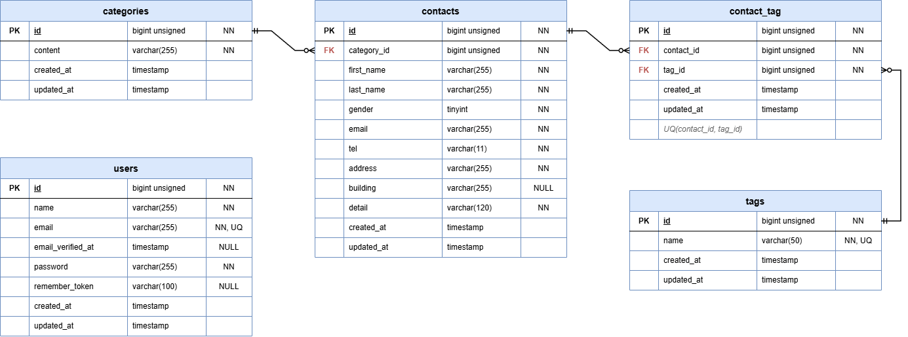

# COACHTECH お問い合わせフォーム

## 概要

COACHTECH の確認テスト提出物として作成した、お問い合わせフォームアプリケーションです。
ユーザーがお問い合わせを送信でき、管理者が内容を検索・閲覧・管理できます。

### 主な機能

- お問い合わせフォームの入力・確認・送信（サンクスページ表示）
- お問い合わせへのタグ付け（複数選択可）
- お問い合わせの検索・一覧表示（管理画面）
- タグマスタ管理（追加・更新・削除）
- 管理者登録
- ログイン / ログアウト

## ER図

## 環境構築手順

### 前提

- Docker / Docker Compose がインストールされていること
- WSL2

### 手順

1. Laravelプロジェクトの作成 (Laravel 10.x)

docker run --rm \
 -u "$(id -u):$(id -g)" \
 -v "$(pwd):/var/www/html" \
 -w /var/www/html \
 -e COMPOSER_CACHE_DIR=/tmp/composer_cache \
 laravelsail/php82-composer:latest \
 composer create-project laravel/laravel:^10.0 contact-form-app

2. Laravel Sailのインストール

- プロジェクトディレクトリに移動
  cd contact-form-app

- Laravel Sailをインストール
  docker run --rm \
   -u ""$(id -u):$(id -g)"" \
   -v ""$(pwd):/var/www/html"" \
   -w /var/www/html \
   -e COMPOSER_CACHE_DIR=/tmp/composer_cache \
   laravelsail/php82-composer:latest \
   composer require laravel/sail --dev

- Sailの設定ファイルをパブリッシュ（MySQLを選択）
  docker run --rm \
   -u ""$(id -u):$(id -g)"" \
   -v ""$(pwd):/var/www/html"" \
   -w /var/www/html \
   -e COMPOSER_CACHE_DIR=/tmp/composer_cache \
   laravelsail/php82-composer:latest \
   php artisan sail:install --with=mysql

3. .env ファイルの設定
   ".env ファイルを開き、データベース接続情報が以下と一致していることを確認します。

DB_CONNECTION=mysql
DB_HOST=mysql
DB_PORT=3306
DB_DATABASE=laravel
DB_USERNAME=sail
DB_PASSWORD=password

重要: DB_HOST は localhost や 127.0.0.1 ではなく、Dockerコンテナ名である mysql を指定します。"

4. フロントエンドのセットアップ (Vite & Tailwind CSS)

- NPM依存パッケージのインストール

※重要: sail npm install を実行する前に、必ずSailコンテナが起動していることを確認してください。
sail npm install

- Tailwind CSSのインストール
  sail npm install -D tailwindcss@^3.4.0 postcss autoprefixer
  sail npm install alpinejs

- 設定ファイルの生成
  sail npx tailwindcss init -p

- Tailwind CSSのテンプレートパス設定
  tailwind.config.js を開き、以下のように設定します。
  /** @type {import(""tailwindcss"").Config} \*/
  export default {
  content: [
  ""./resources/**/_.blade.php"",
  ""./resources/\*\*/_.js"",
  ""./resources/\*_/_.vue"",
  ],
  theme: {
  extend: {},
  },
  plugins: [],
  }

- 提供リポジトリのresourcesディレクトリと入れ替え
  以下のリポジトリをクローンし、resourcesディレクトリを丸ごと入れ替えます。
  git clone https://github.com/coachtech-prepared-file/Preparedblade-ConfirmationTest-ContactForm.git

入れ替え手順:
プロジェクト内の resources フォルダを削除します。
クローンしたリポジトリ内の resources フォルダをプロジェクト直下にコピーします。

- Vite開発サーバーの起動
  sail npm run dev
  注意: sail npm run dev は実行したままにしておく必要があります。"

## 使用技術

| 区分           | 技術                               |
| -------------- | ---------------------------------- |
| 言語           | PHP 8.1 以上                       |
| フレームワーク | Laravel 10                         |
| 認証           | Laravel Fortify                    |
| データベース   | MySQL 8.4                          |
| 開発環境       | Docker（Laravel Sail）、phpMyAdmin |
| フロントエンド | Blade、Tailwind CSS、Vite          |
| コード整形     | Laravel Pint                       |
| テスト         | PHPUnit                            |

## APIエンドポイント一覧

## 開発環境URL

## 作成者

- NGUYEN BAT PHAT （グエン　バット　ファット）
